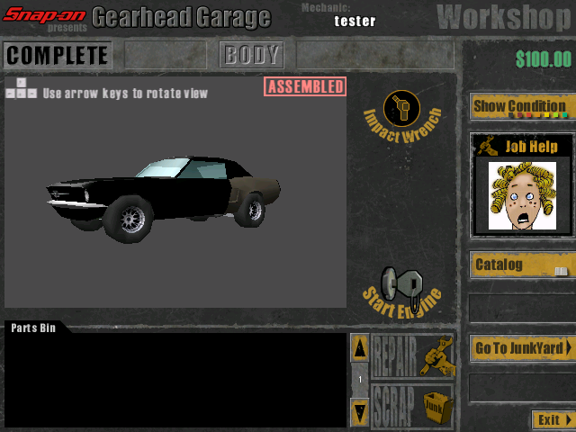
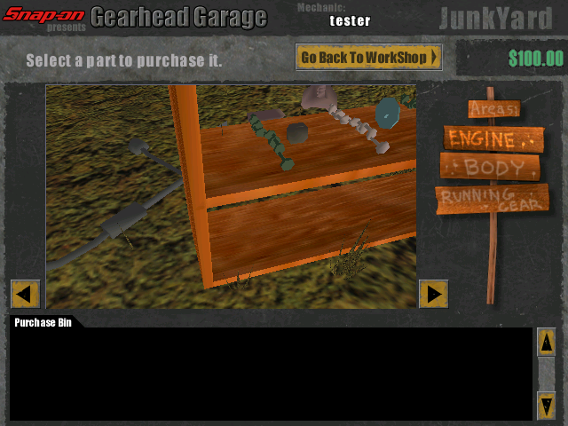
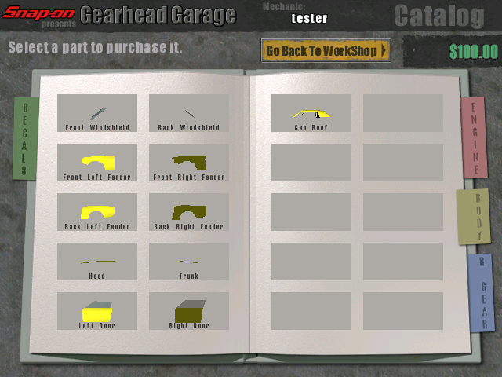
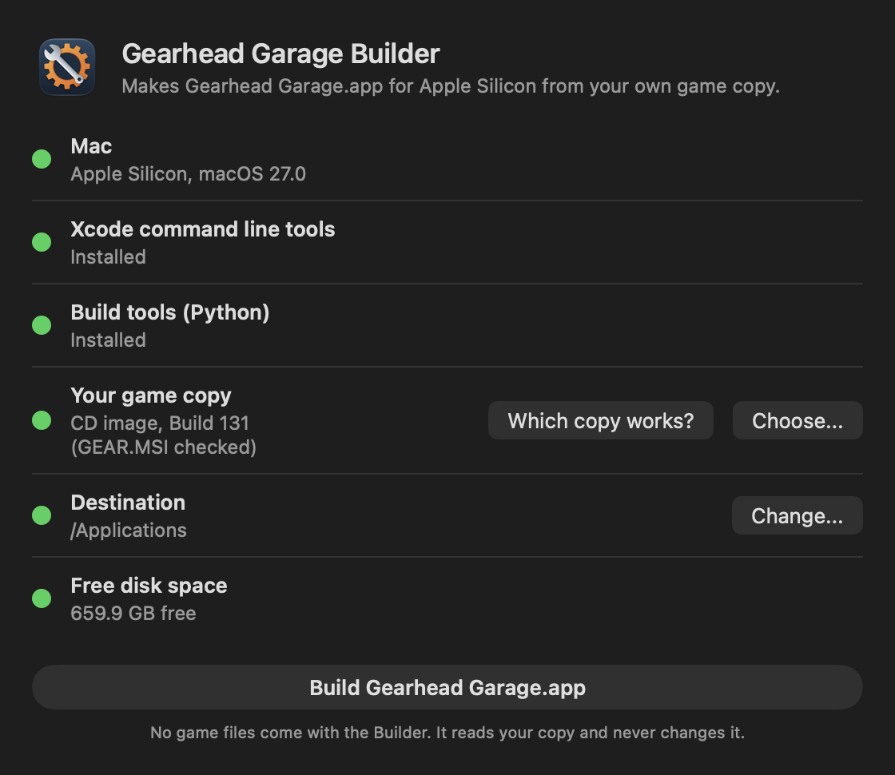
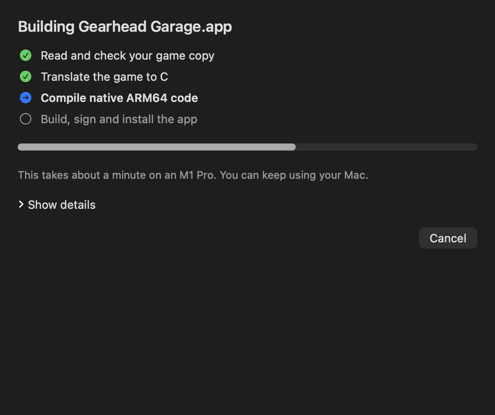

# Gearhead Garage for Apple Silicon Macs

Play **Snap-on Gearhead Garage** (1999), the virtual car mechanic game, as a native Mac app on any Apple Silicon Mac (M1 or later). No Wine, no Windows, no emulator.

> **This repository contains no game files.** It holds only the **Gearhead Garage Builder** and its source code. The Builder takes **your own copy** of the game (a CD image, the CD or an installed game folder) and turns it into a native `Gearhead Garage.app` on your Mac. The game's Windows code is translated to native ARM64 code on your computer, and the game's data is copied from your copy into the app.

<table>
<tr>
<td></td>
<td></td>
<td></td>
</tr>
<tr>
<td align="center">The Workshop, full-color Direct3D drawn with Metal</td>
<td align="center">The JunkYard</td>
<td align="center">The parts Catalog</td>
</tr>
</table>

## How to get it

1. Download **`Gearhead-Garage-Builder.dmg`** from the [Releases page](https://github.com/007hacky007/gearhead-garage-macos-arm64/releases/latest) and open it.
2. Double-click **Gearhead Garage Builder**. The first time, macOS blocks it because it is not signed by Apple: click **Done**, open **System Settings > Privacy & Security**, scroll down and click **Open Anyway**. (On macOS 14 or older: right-click the app and choose **Open**.)
3. Fix any red row with its button: **Install...** for Apple's command line tools, **Install** for the build tools, **Choose...** for your game copy (or drop it on the window).
4. Click **Build Gearhead Garage.app**. About a minute later it is in your Applications folder. Click **Play**.

<table>
<tr>
<td></td>
<td></td>
</tr>
</table>

## What you need

- A Mac with Apple Silicon (M1 or later) and macOS 11 or newer.
- About 1 GB of free disk space while building. The finished app is about 110 MB.
- An internet connection the first time, for Apple's command line tools and a small private Python (about 30 MB). The Builder never downloads the game.
- Your own copy of the game (see below).

## Which copy works

**Snap-on Gearhead Garage, Build 131**: the Activision Value release, also on the *Activision Twin Pack: Snap-On Gear Head Garage & Sprint Car Racing* CD. Any of these works:

- a CD image (`.cue` with its `.bin`, `.bin`, `.img` or `.iso`)
- the CD itself, or a copy of its files
- `GEAR.MSI`, the installer on the CD
- the game folder installed on a Windows PC (with `ghg.exe`)

The Builder checks your copy as soon as you choose it, by the SHA-256 checksum of the installer (`GEAR.MSI`, `8df931e8...`) or of the game program (`ghg.exe`, `f9d797d5...`), and checks all 122 game files again before building. Your copy is only read, never changed. Other releases, such as the original 1999 retail CD, are not supported yet.

## Playing

The app opens a small launcher first: choose **Direct3D (full color)** or **Software (256 colors)**, fullscreen and sound, then click **Play**. The Mac pointer moves the game's glove pointer, the arrow keys turn the car in the Workshop, and Control-Command-F switches fullscreen.

Your mechanics and snapshots are saved in `~/Library/Application Support/Gearhead Garage`, outside the app, so building a new app keeps them. The app carries the whole game, so you can move it anywhere. Keep it to yourself: it contains the game from your copy.

To update, click **Update** in the launcher when it says a new version is available (it checks GitHub's latest release when it opens, or use **Check for Updates...** in its menu). It downloads the new Builder, which builds the new app from the game inside your current one and opens it. You can also open a newer Builder yourself: it finds your `Gearhead Garage.app` the same way.

## Status

Tested so far: creating a mechanic, taking a job, the 3D Workshop, tools and parts, the Catalog, the JunkYard, sound and music, windowed and fullscreen play. A full job from start to finish, the Car Lot and the Auction have not been played through yet. The game's e-mail and online update features are not supported. Please report problems in the [Issues](https://github.com/007hacky007/gearhead-garage-macos-arm64/issues), with the log from the launcher's **Open Logs** button.

## For developers

You can also build from Terminal with `./build.sh /path/to/your/disc.cue`. How the translation works, the full list of checked files, the development tools and the release process are in [docs/TECHNICAL.md](docs/TECHNICAL.md).

## Legal

This project is not affiliated with Snap-on, Activision or the game's developers; their names and trademarks belong to their owners. The repository holds no game code, data or assets. The screenshots above were taken from the port running on a Mac. Third-party source licenses are in [`third_party/`](third_party/).
